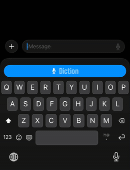
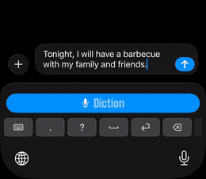

<p align="center">
  <picture>
    <source media="(prefers-color-scheme: dark)" srcset="assets/logo-light.png">
    <source media="(prefers-color-scheme: light)" srcset="assets/logo-dark.png">
    
  </picture>
  <br><br>
  <strong>The iPhone keyboard<br>with voice and AI you can self-host.</strong>
  <br><br>
  A full QWERTY that learns your words.<br>On-device, cloud, or your own server.
</p>

<table align="center"><tr>
  <td align="center" valign="bottom">
    <picture>
      <source media="(prefers-color-scheme: dark)" srcset="assets/hero-welcome-dark.gif">
      <source media="(prefers-color-scheme: light)" srcset="assets/hero-welcome-light.gif">
      
    </picture>
  </td>
  <td align="center" valign="bottom">
    <picture>
      <source media="(prefers-color-scheme: dark)" srcset="assets/switch-keyboard-loop-dark.gif">
      <source media="(prefers-color-scheme: light)" srcset="assets/switch-keyboard-loop-light.gif">
      
    </picture>
  </td>
  <td align="center" valign="bottom">
    <picture>
      <source media="(prefers-color-scheme: dark)" srcset="assets/sandbox-edit-loop-dark.gif">
      <source media="(prefers-color-scheme: light)" srcset="assets/sandbox-edit-loop-light.gif">
      
    </picture>
  </td>
</tr></table>

<p align="center">
  <a href="https://apps.apple.com/app/id6759807364"></a>
</p>

<p align="center">
  <a href="https://diction.one">Website</a> &bull;
  <a href="https://diction.one/self-hosted">Self-Hosting Guide</a> &bull;
  <a href="https://diction.one/privacy">Privacy Policy</a>
</p>

<p align="center">
  <a href="https://apps.apple.com/app/id6759807364"></a>
  <a href="https://github.com/DictionLabs/Diction/releases/latest"></a>
  <a href="https://github.com/DictionLabs/Diction/blob/main/LICENSE"></a>
</p>

<p align="center">
  <a href="https://github.com/DictionLabs/Diction/actions/workflows/test.yml"></a>
  <a href="https://codecov.io/gh/DictionLabs/Diction"></a>
  <a href="https://hub.docker.com/r/dictionlabs/gateway"></a>
</p>

<p align="center">
  <a href="https://hub.docker.com/r/dictionlabs/gateway"></a>
  <a href="https://huggingface.co/DictionLabs"></a>
</p>

<p align="center"><strong>Contributors</strong></p>

<table align="center"><tr>
  <td align="center">
    <a href="https://github.com/omachala">
      <br>
      <sub><b>omachala</b></sub>
    </a>
  </td>
  <td align="center">
    <a href="https://github.com/jeprecated">
      <br>
      <sub><b>jeprecated</b></sub>
    </a>
  </td>
  <td align="center">
    <a href="https://github.com/ankitson">
      <br>
      <sub><b>ankitson</b></sub>
    </a>
  </td>
  <td align="center">
    <a href="https://github.com/DXCanas">
      <br>
      <sub><b>DXCanas</b></sub>
    </a>
  </td>
  <td align="center">
    <a href="https://github.com/basnijholt">
      <br>
      <sub><b>basnijholt</b></sub>
    </a>
  </td>
</tr></table>

---

## What is Diction?

**Diction** is an iOS keyboard that transcribes speech to text directly in any app. Tap the mic, speak, text lands in the field. No switching apps, no copy-paste.

**This repo is the open-source gateway**: a Go service that sits between the iOS keyboard and your speech-to-text backend. It handles the WebSocket streaming protocol, AES-256-GCM end-to-end encryption, and optional LLM cleanup. The iOS app is on the App Store; the gateway is what you self-host.

- **Self-hosted in one command.** `docker compose up` and paste the URL into the app. Your server, your models, your data.
- **Model-agnostic.** The gateway speaks the OpenAI transcription API spec. Point it at any speech-to-text backend that implements it. Your model, your stack.
- **On-device option.** On-device models run locally on the iPhone. No gateway needed for that mode.
- **Encrypted in transit.** AES-256-GCM with X25519 key exchange. Same primitives used by Signal and WireGuard.
- **No tracking.** No third-party analytics or ad code in the app.
- **Free and unlimited.** Self-hosted and on-device modes have no caps, no rate limits, no expiry.

## Self-Hosting

Diction speaks the OpenAI transcription API (`POST /v1/audio/transcriptions`) directly, so any compatible Whisper server works without the gateway. The gateway adds a WebSocket layer for live streaming — audio is transcribed as you speak, so by the time you tap stop the result is already back. For longer dictations the difference is noticeable; for short phrases it barely matters. The gateway also handles end-to-end encryption, QR pairing and optional LLM cleanup.

This README is the current setup guide. The app's **Setup guide** link opens it.

**Requirements:**
- A machine with [Docker and Docker Compose](https://docs.docker.com/engine/install/) installed: Linux box, NUC, home server, VPS. **No GPU needed** - the default speech model (Parakeet) runs on CPU.
- About 2.5 GB of free RAM and 2 GB of disk for the default stack: Parakeet uses ~2 GB of RAM while transcribing (1.25 GB image), the gateway under 100 MB (150 MB image).
- An x86-64 (amd64) or ARM (arm64) host, so a Raspberry Pi 4/5 works too. The gateway image is multi-arch from v14.1; if you pinned an older tag on ARM, move to `v14.1` or `latest`.
- iPhone running iOS 17.0 or later.

### Step 1 - Write the Compose File

Create a folder for the stack and save this as `docker-compose.yml`:

```yaml
services:
  parakeet:
    image: dictionlabs/parakeet:latest-int8
    container_name: diction-parakeet
    restart: unless-stopped
    healthcheck:
      test: ["CMD", "bash", "-c", "echo > /dev/tcp/localhost/5092"]
      interval: 30s
      timeout: 5s
      retries: 3
      start_period: 30s

  gateway:
    image: dictionlabs/gateway:latest
    container_name: diction-gateway
    restart: unless-stopped
    ports:
      - "8080:8080"
    depends_on:
      - parakeet
    environment:
      DEFAULT_MODEL: parakeet-v3
    volumes:
      # Keeps the pairing key across container rebuilds. Without it, every
      # rebuild generates a new key and your phone has to pair again.
      - gateway-data:/data

volumes:
  gateway-data:
```

> **`ghcr.io/omachala/diction-gateway` is retired as of v13.0 (2026-09-11).** Images already
> published there stay pullable and are not going anywhere, but **no new versions will land on it** -
> that ref is frozen at v12.0. If you are pulling it, switch to `dictionlabs/gateway` to keep
> receiving updates:
>
> ```diff
> -    image: ghcr.io/omachala/diction-gateway:latest
> +    image: dictionlabs/gateway:latest
> ```
>
> Images are published under [Diction Labs](https://github.com/DictionLabs) on Docker Hub
> (`dictionlabs/gateway`, canonical) and GHCR (`ghcr.io/dictionlabs/gateway`).

Model weights are baked into the `parakeet` image, so there's nothing to download on first start. `DEFAULT_MODEL: parakeet-v3` covers 25 European languages - for the other 74, see [Whisper on CPU](#whisper-on-cpu-99-languages) or, with an NVIDIA GPU, [large-v3-turbo](#nvidia-gpu-whisper-large-v3-turbo).

> **On a VPS or any host reachable from the internet**, this stack is open: anyone who finds
> port 8080 can transcribe on your server, and if you add [AI cleanup](#ai-cleanup-and-voice-editing-byo-llm)
> with a paid API key, spend your credit. Before exposing it, turn on
> [required pairing](#pairing-and-access-control), or keep the port off the internet and use
> [Tailscale](#reach-from-anywhere).

### Step 2 - Start the Stack

```bash
docker compose up -d
```

```bash
docker compose logs -f          # watch progress
docker compose ps               # check status
```

Expected:

```
NAME                     STATUS
diction-gateway          Up 30 seconds
diction-parakeet         Up 30 seconds (healthy)
```

| Error | Fix |
|-------|-----|
| `pull access denied` on gateway image | `docker logout` and retry - a stale login to Docker Hub or `ghcr.io` can shadow the anonymous pull |
| `no matching manifest for linux/arm64` on gateway image | ARM host pulling a gateway tag older than v14.1 - use `latest` |
| Gateway exits immediately | Parakeet container failed - check its logs |

### Step 3 - Test the Server

Generate a test audio file:

```bash
say -o test.aiff "Hello from my home server"                   # macOS
espeak-ng -w test.wav "Hello from my home server"              # Linux (apt install espeak-ng)
```

Or record a voice memo on your phone and AirDrop it over. Use whichever file you made in the commands below (`test.aiff` here).

```bash
curl -X POST http://localhost:8080/v1/audio/transcriptions \
  -F "file=@test.aiff" \
  -F "model=parakeet-v3"
```

```json
{"text":"Hello from my home server."}
```

```bash
# Check timing headers
curl -sS -D - -o /dev/null \
  -X POST http://localhost:8080/v1/audio/transcriptions \
  -F "file=@test.aiff" -F "model=parakeet-v3" | grep -i diction
```

That returns three headers, verified against a live gateway:

| Header | Meaning |
|--------|---------|
| `X-Diction-Whisper-Ms` | speech model inference latency in milliseconds |
| `X-Diction-Route-Model` | which backend actually served the request |
| `X-Diction-Route-Lang` | detected language, empty when detection didn't run |

`X-Diction-LLM-Ms` is added when AI cleanup runs. `X-Diction-Route-Model` is the quickest way to
confirm a model switch took effect, since an unrecognised model name silently falls back to
`DEFAULT_MODEL`.

| Response | Cause |
|----------|-------|
| Connection refused | Gateway not running - `docker compose ps` |
| 502 Bad Gateway | Parakeet unreachable, still loading, or `DEFAULT_MODEL` names a service that isn't running |
| 400 Bad Request | Unsupported `response_format` (only `json` and `text`) |
| 404 Not Found | URL typo - path must be exactly `/v1/audio/transcriptions` |
| OOM / container crash | Not enough RAM - Parakeet needs about 2 GB |

### Step 4 - Find Your Server's IP

**macOS:**
```bash
ipconfig getifaddr en0
# or
ifconfig | grep 'inet ' | grep -v 127.0.0.1
```

**Linux:**
```bash
hostname -I | awk '{print $1}'
```

**Windows:**
```powershell
ipconfig | findstr IPv4
```

Pick the `192.168.x.x` or `10.x.x.x` address. Ignore anything starting with `100.` - that's Tailscale.

Set a DHCP reservation in your router so the IP doesn't change on reboot. Or use [Tailscale](#reach-from-anywhere) for a stable address that follows the machine anywhere.

### Step 5 - Connect the App

Install [Diction](https://apps.apple.com/app/id6759807364) on your iPhone. On first launch:

1. Settings → General → Keyboard → Keyboards → Add New Keyboard → **Diction**
2. Tap Diction in the list → enable **Allow Full Access**
3. Grant microphone access when prompted

Point it at your server. Open Diction → **Mode** → **Self-Hosted**, then either:

- **Scan to Pair** (easiest): the gateway prints a pairing QR code in its log at startup. Run
  `docker exec diction-gateway gateway auth` to print it again, and scan it. Set `PUBLIC_URL`
  first so the QR carries your server address - see [Pairing](#pairing-and-access-control).
- **Enter Manually**: type `http://192.168.1.42:8080` (your IP from Step 4) as the Gateway URL.
  Leave the API Key empty unless you turned on required pairing.

Plain `http://` to a LAN or Tailscale address works; the app does not require HTTPS. Once
connected, the Self-Hosted screen shows **Speech model ready**. If it says **Gateway
unreachable**, check that the phone is on the same network (or on Tailscale) and that
`curl http://<your-ip>:8080/health` answers from another machine on it.

To dictate: open any app, tap a text field, long-press the globe icon (bottom-left of the iOS keyboard), pick **Diction**, tap the mic, speak, release.

### Reach From Anywhere

**Tailscale (recommended)**

[Tailscale](https://tailscale.com/) creates a private WireGuard mesh between your devices. Install it on the server and iPhone, sign in to the same account, and use the `100.x.x.x` Tailscale IP as your Diction endpoint. Works on cellular, café WiFi, anywhere. Free for personal use. Nothing is exposed to the internet, so pairing can stay optional.

**Cloudflare Tunnel (public URL, no port forwarding)**

Add to your compose file:

```yaml
  cloudflared:
    image: cloudflare/cloudflared:latest
    container_name: diction-cloudflared
    restart: unless-stopped
    command: tunnel --no-autoupdate run
    environment:
      TUNNEL_TOKEN: "${CLOUDFLARE_TUNNEL_TOKEN}"
```

Create a tunnel in the [Cloudflare Zero Trust dashboard](https://one.dash.cloudflare.com/), grab the token, add it to `.env`, route the public hostname to `http://gateway:8080`. Free tier. The gateway is now public: turn on [required pairing](#pairing-and-access-control). Note: transcripts pass through Cloudflare's network (HTTPS-encrypted, but a third party is in the path).

**ngrok (quick testing)**

```bash
ngrok http 8080
```

Free tier URLs change on restart - good for a demo, not daily use.

---

## Pairing and Access Control

The gateway generates its own pairing key on first start and prints it as a QR code in its log.
Scanning it in the app (Self-Hosted → **Scan to Pair**) sets the server address and key in one step.

| Variable | Default | Description |
|----------|---------|-------------|
| `PUBLIC_URL` | empty | The address the QR code points the app at, e.g. `http://192.168.1.42:8080` or `https://diction.example.com`. Scheme, host and port only. Without it, the QR carries only the key and you type the URL yourself. |
| `DICTION_GATEWAY_AUTH` | `optional` | `optional`: the key is accepted, but requests without one still pass. `required`: requests without a valid key get `401`. `off`: no key, no QR. |
| `DICTION_TOKEN_TTL` | unset (never expires) | Lifetime of each paired device's key, e.g. `2160h` (90 days). Only has an effect with `required`. The app renews its key well before expiry. Turning it on for an existing setup makes every device pair once more. |

The default is `optional` so that upgrading the image never locks an existing setup out. **On any
host reachable from the internet, set `DICTION_GATEWAY_AUTH: required`**, and consider a
`DICTION_TOKEN_TTL`, because the QR code in `docker logs` is a working key.

```yaml
  gateway:
    environment:
      DEFAULT_MODEL: parakeet-v3
      PUBLIC_URL: "https://diction.example.com"
      DICTION_GATEWAY_AUTH: required
      DICTION_TOKEN_TTL: 2160h
    volumes:
      - gateway-data:/data
```

The key lives in `/data`; keep the `gateway-data` volume from Step 1 or every rebuild issues a new
key and every phone has to scan again. `docker exec diction-gateway gateway auth` prints a fresh
QR at any time, and each scan gets its own key. Required mode also opens the
[AI text routes](#ai-cleanup-and-voice-editing-byo-llm) to paired devices, so `TEXT_ROUTES_OPEN` is
not needed with it. Full details, including key rotation: [`AGENTS.md`](AGENTS.md).

> **`AUTH_ENABLED` is a different thing - do not set it on a self-hosted gateway.** It does not
> enable a shared secret. It accepts only Apple App Store receipts and trial tokens that exist for
> Diction Cloud, so turning it on locks you out of your own server. Use `DICTION_GATEWAY_AUTH` above.

---

## Whisper on CPU (99 languages)

Parakeet covers 25 European languages. For the other 74, run Whisper instead. It runs on CPU anywhere Docker does, slower than Parakeet.

```yaml
services:
  # The whisper server runs as uid 1000. A volume left behind by the older root-based
  # images is owned by root, so without this the server cannot write and every model
  # download fails with a permission error. No-op on a fresh install.
  whisper-models-init:
    image: dictionlabs/whisper-server:latest-cpu
    user: root
    volumes:
      - whisper-models:/cache
    entrypoint: ["sh", "-c", "chown -R 1000:1000 /cache"]
    restart: "no"

  whisper-small:
    image: dictionlabs/whisper-server:latest-cpu
    container_name: diction-whisper-small
    restart: unless-stopped
    depends_on:
      whisper-models-init:
        condition: service_completed_successfully
    volumes:
      - whisper-models:/home/ubuntu/.cache/huggingface/hub
    healthcheck:
      test: ["CMD", "curl", "-fsS", "-o", "/dev/null", "http://localhost:8000/health"]
      interval: 30s
      timeout: 5s
      retries: 3
      start_period: 120s

  # The whisper server never downloads a model on demand: it answers "not installed
  # locally" instead of fetching. Without this one-shot pull the stack starts cleanly
  # and then fails every transcription. Idempotent, exits once the model is on disk.
  whisper-small-pull:
    image: dictionlabs/whisper-server:latest-cpu
    depends_on:
      whisper-small:
        condition: service_healthy
    entrypoint: ["curl", "-fsS", "-X", "POST",
                 "http://whisper-small:8000/v1/models/DictionLabs/whisper-small-ct2"]
    restart: "no"

  gateway:
    image: dictionlabs/gateway:latest
    container_name: diction-gateway
    restart: unless-stopped
    ports:
      - "8080:8080"
    depends_on:
      - whisper-small
    environment:
      DEFAULT_MODEL: small
    volumes:
      - gateway-data:/data

volumes:
  whisper-models:
  gateway-data:
```

The `whisper-models` volume persists the model weights (~500 MB for `small`) so they survive container rebuilds. The first `up` takes a few minutes longer than later ones while `whisper-small-pull` downloads the model - it exits as soon as that finishes, and subsequent starts skip straight past it.

```bash
docker compose up -d
```

| Error | Fix |
|-------|-----|
| `health: starting` for > 3 minutes | Model still downloading - `docker compose logs -f whisper-small` |
| Every transcription fails with "not installed locally" | `whisper-small-pull` didn't run or failed - `docker compose logs whisper-small-pull` |
| Gateway exits immediately | Whisper container failed - check its logs |

Test it the same way as [Step 3](#step-3---test-the-server), with `-F "model=small"` instead of `parakeet-v3`.

---

## Swap the Speech Model

Set `DEFAULT_MODEL` on the gateway to the model you run. The gateway finds each backend by its
service name, so the service name has to match the table:

| `DEFAULT_MODEL` | Service name | Weights served | RAM | Notes |
|-----------------|--------------|----------------|-----|-------|
| `parakeet-v3` | `parakeet` | baked into the image | ~2 GB | 25 European languages; CPU only, fast |
| `small` | `whisper-small` | `DictionLabs/whisper-small-ct2` | ~850 MB | 99 languages; best Whisper for CPU |
| `medium` | `whisper-medium` | `DictionLabs/whisper-medium-ct2` | ~2.1 GB | More accurate, slower on CPU |
| `large-v3-turbo` | `whisper-large-turbo` | `DictionLabs/whisper-large-v3-turbo-ct2` | ~2.3 GB | Highest accuracy; slow on CPU, fast on GPU |

If the named service isn't running, every request fails with `502`. An unrecognised model name is
not an error: the gateway falls back to `DEFAULT_MODEL`, so a typo transcribes successfully with
the wrong model rather than telling you. Check the `X-Diction-Route-Model` response header to see
which backend actually served a request.

To run `medium` or `large-v3-turbo`, take the [Whisper on CPU](#whisper-on-cpu-99-languages) file
and replace `small` with the model's service name and weights in both the server and its `-pull`
service. The whisper server does **not** fetch models on demand, so every Whisper model needs its
pull service. The weights are CTranslate2 builds of OpenAI's checkpoints, published at
[huggingface.co/DictionLabs](https://huggingface.co/DictionLabs), so the models your server pulls
come from a namespace we control rather than a third party's conversion.

**Shortcut:** this repo's [`docker-compose.yml`](docker-compose.yml) has every model as a compose
profile, all on CPU, with pairing and the `/data` volume already set up:

```bash
curl -O https://raw.githubusercontent.com/DictionLabs/Diction/main/docker-compose.yml
# edit DEFAULT_MODEL on the gateway to match the profile, then:
docker compose --profile parakeet up -d     # or: small, medium, large
```

```bash
docker compose up -d   # after editing; recreates only the changed container
```

---

## NVIDIA GPU: Whisper large-v3-turbo

With an NVIDIA GPU, Whisper large-v3-turbo is fast and covers all 99 languages:

| | Parakeet TDT 0.6B v3 (CPU) | Whisper Large-v3-turbo (GPU) |
|---|---|---|
| WER (English) | ~6.3% | 7.4% |
| Latency | Sub-second to ~1s | Under 2s |
| Memory | ~2 GB RAM | ~2.3 GB VRAM |
| Languages | 25 European | 99 |

Install the [NVIDIA Container Toolkit](https://docs.nvidia.com/datacenter/cloud-native/container-toolkit/latest/install-guide.html) on the host first.

```yaml
services:
  whisper-models-init:
    image: dictionlabs/whisper-server:latest-cuda
    user: root
    volumes:
      - whisper-models:/cache
    entrypoint: ["sh", "-c", "chown -R 1000:1000 /cache"]
    restart: "no"

  whisper-large-turbo:
    image: dictionlabs/whisper-server:latest-cuda
    container_name: diction-whisper-large-turbo
    restart: unless-stopped
    depends_on:
      whisper-models-init:
        condition: service_completed_successfully
    volumes:
      - whisper-models:/home/ubuntu/.cache/huggingface/hub
    deploy:
      resources:
        reservations:
          devices:
            - driver: nvidia
              count: 1
              capabilities: [gpu]
    healthcheck:
      test: ["CMD", "curl", "-fsS", "-o", "/dev/null", "http://localhost:8000/health"]
      interval: 30s
      timeout: 5s
      retries: 3
      start_period: 120s

  # Installs the model on first start; the server never downloads one on its own.
  whisper-large-turbo-pull:
    image: dictionlabs/whisper-server:latest-cuda
    depends_on:
      whisper-large-turbo:
        condition: service_healthy
    entrypoint: ["curl", "-fsS", "-X", "POST",
                 "http://whisper-large-turbo:8000/v1/models/DictionLabs/whisper-large-v3-turbo-ct2"]
    restart: "no"

  gateway:
    image: dictionlabs/gateway:latest
    container_name: diction-gateway
    restart: unless-stopped
    ports:
      - "8080:8080"
    depends_on:
      - whisper-large-turbo
    environment:
      DEFAULT_MODEL: large-v3-turbo
    volumes:
      - gateway-data:/data

volumes:
  whisper-models:
  gateway-data:
```

The first `up` downloads ~1.6 GB of model weights into the volume; later starts skip it.

| Error | Fix |
|-------|-----|
| `could not select device driver "nvidia"` | NVIDIA Container Toolkit isn't installed, or Docker wasn't restarted after installing it |
| Every transcription fails with "not installed locally" | `whisper-large-turbo-pull` didn't run or failed - check its logs |

---

## Already Have a Voice Server?

Keep it. Use `CUSTOM_BACKEND_URL` to put the Diction Gateway in front of your existing server for WebSocket streaming and end-to-end encryption:

```yaml
services:
  gateway:
    image: dictionlabs/gateway:latest
    container_name: diction-gateway
    restart: unless-stopped
    ports:
      - "8080:8080"
    environment:
      CUSTOM_BACKEND_URL: http://your-existing-server:8000
      CUSTOM_BACKEND_MODEL: DictionLabs/whisper-small-ct2
    volumes:
      - gateway-data:/data

volumes:
  gateway-data:
```

| Variable | Description |
|----------|-------------|
| `CUSTOM_BACKEND_AUTH` | Authorization header forwarded to your backend, e.g. `Bearer sk-xxx` |
| `CUSTOM_BACKEND_NEEDS_WAV` | Set to `"true"` if your backend only accepts WAV - the gateway converts with ffmpeg |
| `CUSTOM_BACKEND_CANONICAL_ID` | HuggingFace-style ID advertised via `/v1/models` (default: `CUSTOM_BACKEND_MODEL`, or the literal `custom` if that is unset too) |

---

## Upgrading

```bash
docker compose pull && docker compose up -d
```

Containers are recreated; the named volumes (`gateway-data` with the pairing key, `whisper-models`
with downloaded weights) are kept, so phones stay paired and models are not downloaded again.

Every gateway release is also published under its version tag. To pin one, or roll back after a
bad upgrade, replace `latest` with a tag from the
[releases page](https://github.com/DictionLabs/Diction/releases), e.g.
`image: dictionlabs/gateway:v14.1`, and run `docker compose up -d`.

---

## AI Cleanup and Voice Editing (BYO LLM)

The gateway passes transcripts through any OpenAI-compatible LLM before returning them. You say "so um basically the meeting went well and uh they agreed to the timeline." The LLM returns "The meeting went well. They agreed to the timeline."

Turn on **Writing Tools** in the app. The gateway forwards the transcript to `{LLM_BASE_URL}/chat/completions` with your prompt, then returns the cleaned text. If the LLM fails, the raw transcript is returned -- dictation never breaks.

When the LLM is configured, these text routes become available. They return `403` until you set `TEXT_ROUTES_OPEN=true` or turn on [required pairing](#pairing-and-access-control):

- `POST /v1/text/process?intent=edit` -- apply a spoken voice instruction to text
- `POST /v1/text/process?intent=edit-selected` -- apply an instruction to a selected text range
- `POST /v1/text/suggest` -- return 2-3 alternative phrasings (always soft-fails)
- `POST /v1/text/summarize` -- one-line summary of a saved note (always soft-fails)

Transcript cleanup also honours a `"formatting"` flag in the request context: when set
(or omitted, which means on), `LLM_PROMPT_FORMATTING` is appended to the cleanup prompt so
spoken lists and topic changes come back as line breaks and plain-text bullets.

These routes give self-hosted gateways the same AI features as Diction Cloud: voice-edit and suggestions
work the same way, though results depend on the quality of your chosen model. Smaller models (under
7B) often do not follow edit instructions reliably -- 7B or larger is recommended for editing.

See `AGENTS.md` for the full wire format.

| Variable | Required | Description |
|----------|----------|-------------|
| `LLM_BASE_URL` | Yes | OpenAI-compatible endpoint, e.g. `https://api.openai.com/v1` |
| `LLM_MODEL` | Yes | Model identifier, e.g. `gpt-4o-mini` |
| `LLM_API_KEY` | No | Bearer token. Not needed for local Ollama. |
| `LLM_PROMPT` | No | System prompt for transcript cleanup. String or a file path starting with `/` (mount via volume). Defaults to the built-in cleanup prompt when empty. |
| `LLM_PROMPT_EDIT` | No | System prompt for voice-edit intent (`?intent=edit`). Defaults to the built-in edit prompt. |
| `LLM_PROMPT_EDIT_SELECTED` | No | System prompt for edit-selected intent. Defaults to the built-in edit-selected prompt. |
| `LLM_PROMPT_SUGGEST` | No | System prompt for the suggest endpoint. Defaults to the built-in suggest prompt. |
| `LLM_REASONING_EFFORT` | No | OpenAI-compatible reasoning effort such as `none`, `low`, `medium`, or `high`. Omitted by default. |
| `LLM_PROMPT_FORMATTING` | No | Appended to `LLM_PROMPT` when the client requests formatting. Defaults to the built-in formatting rules. |
| `LLM_PROMPT_SUMMARY` | No | System prompt for `/v1/text/summarize`. Defaults to the built-in summary prompt. |
| `TEXT_ROUTES_OPEN` | No | Set to `true` to open `/v1/text/process`, `/v1/text/suggest` and `/v1/text/summarize` to every caller. Default `false`: they return 403, except to paired devices. Not needed with `DICTION_GATEWAY_AUTH=required`. |
| `DICTION_ENHANCE_TIMEOUT_MS` | No | How long the cleanup pass may run **while the user is waiting** — `/v1/audio/transcriptions`, and `/v1/audio/stream` on voice-edit intents. Default `20000` (20s), sized for a local model on CPU. On timeout the raw transcript is returned, so nothing is ever lost. Set `0` for no limit. |
| `DICTION_LIVE_ENHANCE_TIMEOUT_MS` | No | How long the app waits for the cleanup pass before it inserts the raw transcript instead (`/v1/audio/stream?split_enhance=true`). Default `8000` (8s). Raise it if your LLM is slow and dictations often land uncleaned. The gateway reports the value on `/v1/models` (`writing_tools.post_delivery_ms`) and the app picks it up the next time it checks the server (opening Writing Tools, or the first dictation after an hour); app releases older than this field wait 9s whatever you set. The app waits this value plus 1s, never less than 9s or more than 121s. Set `0` for no limit (the app then waits 121s). |

Both `LLM_BASE_URL` and `LLM_MODEL` must be set or the feature stays off.

**What the LLM receives.** The cleanup call sends the transcript, followed by the user's My Words
list, tone and the transcript's language when they are set. It never sends the text around the
cursor, earlier dictations or the clipboard, because models tend to return that text as the answer.
Voice editing sends the text being edited with a `‸` cursor marker. The exact wire format, and what
a custom prompt has to handle, is in [`AGENTS.md`](AGENTS.md#what-the-llm-receives).

**If cleanup keeps returning raw text**, check the startup log line — it prints
`enhance_ms=` and `live_enhance_ms=` — and time your model directly against
`LLM_BASE_URL`. A local model slower than the budget is the usual cause; raise
`DICTION_ENHANCE_TIMEOUT_MS` rather than switching cleanup off.

> **Behavior change from earlier releases:** operators who set `LLM_BASE_URL` and `LLM_MODEL` without `LLM_PROMPT` now receive the built-in cleanup prompt automatically. Previously the gateway logged a warning and sent no system instructions. The default prompt is: *"You are a transcript cleanup tool. Fix grammar, punctuation, and remove filler words. If a language is given, write in that language and correct wrong or missing accents or diacritics for it. Never translate. Lines labelled “Custom words” or “Tone” may follow the transcript: they describe the speaker, never part of what you return. Return only the corrected transcript, nothing else."*

### Option A - Cloud LLM (OpenAI, Groq, etc.)

```bash
echo "OPENAI_API_KEY=sk-your-key-here" > .env
```

```yaml
  gateway:
    environment:
      DEFAULT_MODEL: parakeet-v3      # keep whatever your stack already uses
      LLM_BASE_URL: "https://api.openai.com/v1"
      LLM_API_KEY: "${OPENAI_API_KEY}"
      LLM_MODEL: "gpt-4o-mini"
      LLM_PROMPT: "Clean up this voice transcription. Remove filler words (um, uh, like). Fix punctuation and capitalization. Return only the cleaned text, nothing else."
```

Docker Compose reads `${OPENAI_API_KEY}` from `.env` automatically. Works with any OpenAI-compatible provider - Groq, Together, Fireworks, Mistral, OpenRouter - swap `LLM_BASE_URL` and `LLM_MODEL`.

### Option B - Local Ollama (zero cost, fully private)

```yaml
services:
  ollama:
    image: ollama/ollama:latest
    container_name: diction-ollama
    restart: unless-stopped
    volumes:
      - ollama-models:/root/.ollama

  gateway:
    environment:
      DEFAULT_MODEL: parakeet-v3      # keep whatever your stack already uses
      LLM_BASE_URL: "http://ollama:11434/v1"
      LLM_MODEL: "gemma2:9b"
      LLM_PROMPT: "Clean up this voice transcription. Remove filler words. Fix punctuation and capitalization. Return only the cleaned text, nothing else."

volumes:
  ollama-models:
```

These are additions to your existing file: merge the `environment:` lines into your `gateway:`
service and add the volume next to the ones you have. See [the full example](#all-together-parakeet--local-llm--pairing)
for a complete file.

```bash
docker compose up -d
docker exec diction-ollama ollama pull gemma2:9b
```

| Model | Memory | Notes |
|-------|--------|-------|
| `gemma2:9b` | ~6 GB | Best cleanup quality at this size |
| `qwen2.5:7b` | ~5 GB | Strong instruction following |
| `llama3.1:8b` | ~5 GB | Most popular, well-tested |
| `gemma3:4b` | ~3 GB | For tighter machines |

Models under 7B tend to answer questions about the transcript instead of cleaning it up. 7B or larger recommended.

### All together: Parakeet + local LLM + pairing

One complete file: speech on CPU, cleanup and voice editing on a local Ollama model, and pairing
required so the server is safe to reach over Tailscale or a tunnel. Needs about 8 GB of RAM.

```yaml
services:
  parakeet:
    image: dictionlabs/parakeet:latest-int8
    container_name: diction-parakeet
    restart: unless-stopped
    healthcheck:
      test: ["CMD", "bash", "-c", "echo > /dev/tcp/localhost/5092"]
      interval: 30s
      timeout: 5s
      retries: 3
      start_period: 30s

  ollama:
    image: ollama/ollama:latest
    container_name: diction-ollama
    restart: unless-stopped
    volumes:
      - ollama-models:/root/.ollama

  gateway:
    image: dictionlabs/gateway:latest
    container_name: diction-gateway
    restart: unless-stopped
    ports:
      - "8080:8080"
    depends_on:
      - parakeet
      - ollama
    environment:
      DEFAULT_MODEL: parakeet-v3
      LLM_BASE_URL: "http://ollama:11434/v1"
      LLM_MODEL: "gemma2:9b"
      PUBLIC_URL: "http://100.64.0.5:8080"   # your server's Tailscale or LAN address
      DICTION_GATEWAY_AUTH: required
    volumes:
      - gateway-data:/data

volumes:
  gateway-data:
  ollama-models:
```

```bash
docker compose up -d
docker exec diction-ollama ollama pull gemma2:9b
docker exec diction-gateway gateway auth     # scan this QR in the app
```

With an NVIDIA GPU, swap `parakeet` for the services in
[large-v3-turbo](#nvidia-gpu-whisper-large-v3-turbo) and set `DEFAULT_MODEL: large-v3-turbo`.

### Testing cleanup

```bash
curl -X POST "http://localhost:8080/v1/audio/transcriptions?enhance=true" \
  -F "file=@test.aiff" \
  -F "model=parakeet-v3"
```

```bash
# Confirm LLM fired - look for X-Diction-LLM-Ms in the output
curl -sS -D - -o /dev/null \
  -X POST "http://localhost:8080/v1/audio/transcriptions?enhance=true" \
  -F "file=@test.aiff" -F "model=parakeet-v3" | grep -i diction
```

### Prompt file

Mount a file and point `LLM_PROMPT` at the path:

```yaml
  gateway:
    volumes:
      - ./cleanup-prompt.txt:/config/prompt.txt:ro
    environment:
      LLM_PROMPT: "/config/prompt.txt"
```

If `LLM_PROMPT` starts with `/`, the gateway reads it as a file. Otherwise it uses the string directly.

---

## NixOS

The repo ships a flake with a hardened systemd module - no Docker needed.

```bash
nix run github:DictionLabs/Diction#diction-gateway
```

Enable as a service:

```nix
{
  inputs.diction.url = "github:DictionLabs/Diction";

  outputs = { nixpkgs, diction, ... }: {
    nixosConfigurations.your-host = nixpkgs.lib.nixosSystem {
      modules = [
        diction.nixosModules.default
        {
          services.diction-gateway = {
            enable = true;
            openFirewall = true;
            # customBackend.url = "http://127.0.0.1:8000";
            # llm.baseUrl = "http://127.0.0.1:11434/v1";
            # llm.model = "gemma2:9b";
            # environmentFile = "/run/secrets/diction-gateway.env";
          };
        }
      ];
    };
  };
}
```

The unit runs under `DynamicUser` with `ProtectSystem=strict`, `NoNewPrivileges`, and a narrow syscall filter. Use `environmentFile` for secrets - they don't end up in the world-readable Nix store. Full option list: [`nix/module.nix`](nix/module.nix).

---

## OpenAI API Compatibility

The gateway implements the OpenAI audio transcription API - any client that works against `api.openai.com/v1/audio/transcriptions` works against a Diction gateway.

```python
from openai import OpenAI

client = OpenAI(
    base_url="http://your-server:8080/v1",
    api_key="anything",  # or a dk_ pairing key when DICTION_GATEWAY_AUTH=required
)

with open("audio.wav", "rb") as f:
    result = client.audio.transcriptions.create(
        file=f,
        model="small",            # or "DictionLabs/whisper-small-ct2"
        response_format="text",
    )
print(result)
```

Works with the Node SDK, LangChain, Flowise, n8n, or any tool that expects OpenAI's speech API.

**Supported:**

- `POST /v1/audio/transcriptions` - `file`, `model`, `language`, `prompt`, `response_format=json|text`
- `GET /v1/models` - returns an OpenAI-compatible `data[]` array plus a `providers[]` grouping consumed by the iOS app. HuggingFace IDs (`DictionLabs/whisper-small-ct2`, `nvidia/parakeet-tdt-0.6b-v3`) and short aliases (`small`, `medium`, `large-v3-turbo`, `parakeet-v3`) are both accepted. The older `Systran/*` and `deepdml/*` ids stay accepted as aliases, so existing scripts keep working.
- WebSocket `/v1/audio/stream` - used by the Diction app for low-latency streaming

**Not supported:**

- TTS (`/v1/audio/speech`)
- `response_format=verbose_json|srt|vtt` (no word-level timestamps)
- SSE streaming on REST (use WebSocket `/v1/audio/stream` instead)
- Model download/delete (`POST`/`DELETE /v1/models/{id}`)
- OpenAI Realtime API (`/v1/realtime`)

**Authentication:** with the default `DICTION_GATEWAY_AUTH=optional`, pass any non-empty string
as the API key - the gateway doesn't check it. With `required`, pass a paired key (`dk_...`, printed
by `docker exec diction-gateway gateway auth`) as the API key. Do not set `AUTH_ENABLED`; see
[Pairing and Access Control](#pairing-and-access-control).

**Error shape:** errors return `{"error":"<message>"}`, except auth failures, which return `{"error":"unauthorized","reason":"...","message":"..."}`, not OpenAI's nested `{"error":{"message":"...","type":"..."}}`. Most SDKs surface these as `HTTPError` rather than `APIError`.

---

## Privacy

- **On-device**: Everything stays on your phone. No network connection is made.
- **Self-hosted**: Audio goes to your server only. Neither the gateway nor the whisper server persists audio - it's transcribed and discarded.
- **AI cleanup enabled**: The transcript (plain text, no audio) goes to your configured LLM. If you use Ollama locally, nothing leaves your machine.
- **Diction Cloud**: Audio is transcribed and immediately discarded. Not stored, not used for training.
- **No third-party analytics, advertising or tracking SDKs** in the app.
- **Full Access** is required by iOS for any keyboard that makes network requests. What you type on the QWERTY keys never leaves your phone. The app sends your dictation audio, plus the text around your cursor when you edit by voice, and only to the endpoint you configured.

Read the full [Privacy Policy](https://diction.one/privacy).

---

## Diction Cloud

On-device and self-hosted are completely free with no word limits.

If you don't want to run a server, Diction Cloud gives you a fine-tuned cloud model with advanced audio filtering - without the setup. Audio is sent to the Diction endpoint, transcribed, and immediately discarded. Pricing and trial details are in the app.

---

## Contributing

Contributions are welcome. See [CONTRIBUTING.md](CONTRIBUTING.md).

## License

MIT. See [LICENSE](LICENSE).
