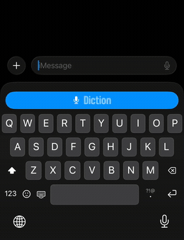
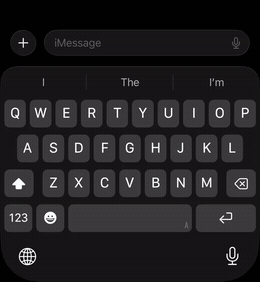
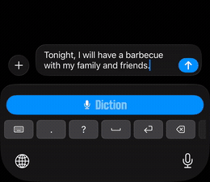
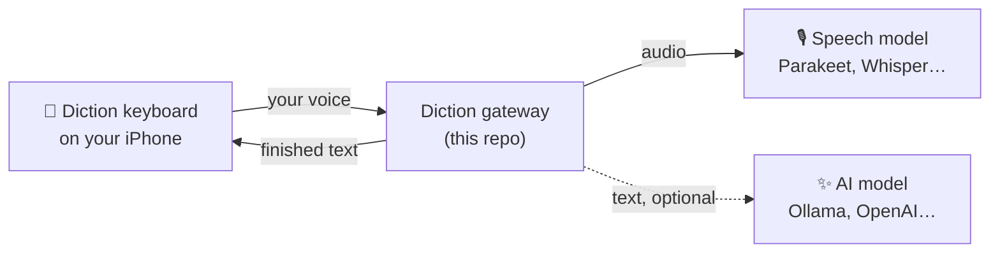

<p align="center">
  <picture>
    <source media="(prefers-color-scheme: dark)" srcset="assets/logo-light.png">
    <source media="(prefers-color-scheme: light)" srcset="assets/logo-dark.png">
    
  </picture>
  <br><br>
  <strong>The iPhone keyboard with voice and AI you can self-host.</strong><br>
  A full keyboard that learns your words. On your iPhone, in the cloud, or on your own server.
</p>

<table align="center"><tr>
  <td align="center" valign="bottom">
    <picture>
      <source media="(prefers-color-scheme: dark)" srcset="assets/hero-welcome-dark.gif">
      <source media="(prefers-color-scheme: light)" srcset="assets/hero-welcome-light.gif">
      
    </picture>
  </td>
  <td align="center" valign="bottom">
    <picture>
      <source media="(prefers-color-scheme: dark)" srcset="assets/switch-keyboard-loop-dark.gif">
      <source media="(prefers-color-scheme: light)" srcset="assets/switch-keyboard-loop-light.gif">
      
    </picture>
  </td>
  <td align="center" valign="bottom">
    <picture>
      <source media="(prefers-color-scheme: dark)" srcset="assets/sandbox-edit-loop-dark.gif">
      <source media="(prefers-color-scheme: light)" srcset="assets/sandbox-edit-loop-light.gif">
      
    </picture>
  </td>
</tr></table>

<p align="center">
  <br>
  <a href="https://apps.apple.com/app/id6759807364"></a>
  <br><br>
</p>

<p align="center">
  <a href="https://diction.one">Website</a> &bull;
  <a href="https://diction.one/self-hosted">Self-Hosting Guide</a> &bull;
  <a href="https://diction.one/privacy">Privacy Policy</a>
</p>

<p align="center">
  <a href="https://apps.apple.com/app/id6759807364"></a>
  <a href="https://github.com/DictionLabs/Diction/releases/latest"></a>
  <a href="https://github.com/DictionLabs/Diction/blob/main/LICENSE"></a>
  <a href="https://github.com/DictionLabs/Diction/actions/workflows/test.yml"></a>
  <a href="https://hub.docker.com/r/dictionlabs/gateway"></a>
</p>

<p align="center">
  <a href="https://github.com/omachala"></a>
  <a href="https://github.com/jeprecated"></a>
  <a href="https://github.com/ankitson"></a>
  <a href="https://github.com/DXCanas"></a>
  <a href="https://github.com/basnijholt"></a>
  <a href="https://github.com/testyfishy"></a>
</p>

---

## What is Diction?

Diction is a keyboard for your iPhone that you can talk to. Tap the mic in any app, say what you mean, and get text you can send as it is. Under the mic sits a full keyboard that learns your words, so you never have to switch back to Apple's.

Your voice goes where you choose. It can stay on your phone, go to Diction Cloud, or go to a server you run yourself. On your phone and on your own server, Diction is free, with no account and no limits.

**This repo is the part you run yourself.** It's a small server, the Diction gateway, that sits between the keyboard and a speech model of your choice. It streams your voice while you talk, so the text is ready almost as soon as you stop. It keeps that audio encrypted on the way, and it can tidy the text with an AI model you pick.



## Set up your own server

You'll run a small speech server at home, and your iPhone will send your voice there instead of to someone else's cloud.

**What you need:**

- Any computer that runs [Docker](https://docs.docker.com/engine/install/): a home server, a NUC, a Raspberry Pi 4 or 5, or a small VPS. No graphics card needed.
- About 3 GB of free memory and 2 GB of disk space.
- An iPhone on iOS 17 or newer, with [Diction from the App Store](https://apps.apple.com/app/id6759807364) installed.

Then follow the five steps below. Click a step to open it.

<details>
<summary><b>Step 1 - Write the compose file</b></summary>
<br>

Make a folder and save this in it as `docker-compose.yml`:

```yaml
services:
  parakeet:
    image: dictionlabs/parakeet:latest-int8
    container_name: diction-parakeet
    restart: unless-stopped
    healthcheck:
      test: ["CMD", "bash", "-c", "echo > /dev/tcp/localhost/5092"]
      interval: 30s
      timeout: 5s
      retries: 3
      start_period: 30s

  gateway:
    image: dictionlabs/gateway:latest
    container_name: diction-gateway
    restart: unless-stopped
    ports:
      - "8080:8080"
    depends_on:
      - parakeet
    environment:
      DEFAULT_MODEL: parakeet-v3
    volumes:
      # Keeps your phone paired when the container is rebuilt.
      - gateway-data:/data

volumes:
  gateway-data:
```

This uses Parakeet, a fast speech model that runs on any CPU and knows 25 European languages. Need another language? Swap in Whisper, which knows 99: see [Speech models](docs/speech-models.md).

> **Is your server reachable from the internet?** Then anyone who finds it can use it. Turn on
> [pairing](docs/pairing.md) first, or keep it private with [Tailscale](docs/remote-access.md).

</details>

<details>
<summary><b>Step 2 - Start it</b></summary>
<br>

```bash
docker compose up -d
```

Give it half a minute, then check that both containers are up:

```bash
docker compose ps
```

Something not starting? See [Troubleshooting](docs/troubleshooting.md).

</details>

<details>
<summary><b>Step 3 - Check that it hears you</b></summary>
<br>

Make a short recording:

```bash
say -o test.wav --data-format=LEI16@16000 "Hello from my home server"   # on a Mac
espeak-ng -w test.wav "Hello from my home server"                        # on Linux
```

Send it to your server:

```bash
curl -X POST http://localhost:8080/v1/audio/transcriptions \
  -F "file=@test.wav" -F "model=parakeet-v3"
```

You should get your words back:

```json
{"text":"Hello from my home server."}
```

</details>

<details>
<summary><b>Step 4 - Find your server's address</b></summary>
<br>

On Linux, run `hostname -I`; on a Mac, `ipconfig getifaddr en0`. You're looking for something like `192.168.1.42`.

Tip: give the server a fixed address in your router, so it doesn't change after a restart.

</details>

<details>
<summary><b>Step 5 - Connect your iPhone</b></summary>
<br>

1. Open Diction and follow its setup to turn on the keyboard.
2. In the app, open **Mode** and choose **Self-Hosted**.
3. Tap **Scan to Pair** and scan the QR code that the server prints. To see it again, run `docker exec diction-gateway gateway auth`. Or tap **Enter Manually** and type your address, like `http://192.168.1.42:8080`.

When the app says **Speech model ready**, you're done. Open any app, switch to the Diction keyboard, tap the mic and talk.

</details>

## Make it yours

Once it works, there's plenty more you can do:

- **Use it away from home.** Tailscale is the easy way; a Cloudflare tunnel works too. → [Away from home, safely](docs/remote-access.md)
- **Lock it to your own phones.** Only paired devices get in. → [Pairing](docs/pairing.md)
- **Speak more languages, or use your GPU.** Run Whisper on a CPU or an NVIDIA card, or keep the speech server you already have. → [Speech models](docs/speech-models.md)
- **Let AI tidy your words.** Plug in Ollama or any OpenAI-compatible model, and filler words go, punctuation lands, and you can edit text just by saying what to change. → [AI cleanup](docs/ai-cleanup.md)
- **See your words as you talk.** → [Live text](docs/live-text.md)
- **Run it on NixOS** without Docker. → [NixOS](docs/nixos.md)
- **Use it from your own scripts.** It speaks the OpenAI transcription API. → [OpenAI API](docs/openai-api.md)

Updating is one line: `docker compose pull && docker compose up -d`. Your phones stay paired. More in [Upgrading](docs/upgrading.md).

Something wrong? Start with [Troubleshooting](docs/troubleshooting.md). For every route and setting in one place, see [`AGENTS.md`](AGENTS.md).

## Privacy

On your phone, nothing leaves it. On your own server, your voice goes to that server and nowhere else, and it's thrown away once it's turned into text. With Diction Cloud, it's transcribed on Diction's servers and thrown away too: never stored, never used for training.

The keyboard has no ads and no tracking, and what you type on the keys never leaves your phone. iOS asks you to allow Full Access only because the keyboard needs the network to send your voice to the place you picked. The full story is in the [Privacy Policy](https://diction.one/privacy).

## Diction Cloud

Don't want to run a server? Diction Cloud does it for you, with no setup. Diction runs the speech models and the AI on its own GPU servers. You get the most accurate transcription and every writing tool from the first tap. There's a free trial in the app.

## Contributing

Contributions are welcome. See [CONTRIBUTING.md](CONTRIBUTING.md).

## License

MIT. See [LICENSE](LICENSE).
